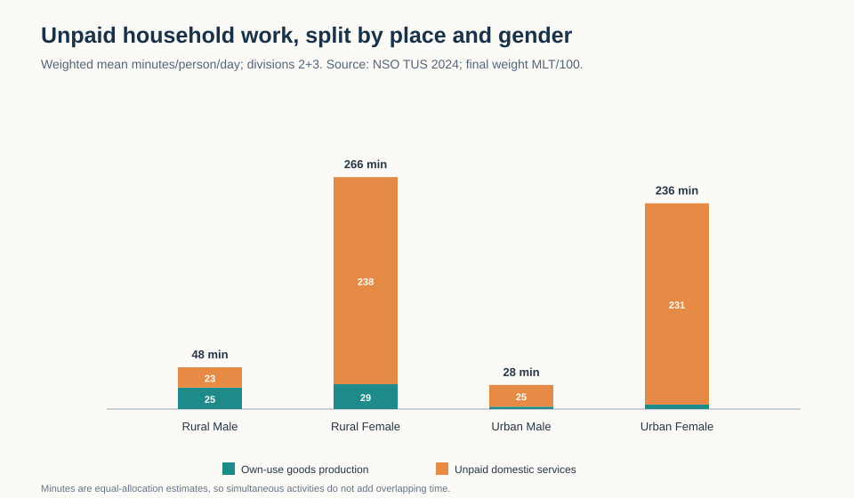

# The Uncounted Economy

### Water, firewood, cattle: work that GDP does not see

This project was developed as coursework for the **Tools in Data Science (TDS) subject at IIT Madras**, as part of Group Assignment 4, Question 3. It analyzes India's Time Use Survey (TUS) 2024 and turns findings about unpaid household work into poster-ready evidence and charts.

## Coursework context

The coursework asked teams to independently investigate the official TUS 2024 data, work within an assigned theme, find defensible statistical patterns, and communicate a result in a short collaborative poster session. The live activity had three phases: individual idea writing, a unanimous team choice, and poster creation with Designer, Writer, and Reviewer roles.

The theme tracks shown for the activity were:

- The Second Shift
- Hours on the Road
- Who Gets an Evening?
- School Bags and Water Pots
- Parents on Duty
- **The Uncounted Economy** (our assigned theme)

Our project stayed within own-use goods production and unpaid domestic services: household agriculture and animal products, water and firewood collection, gender and rural/urban differences, state patterns, and household characteristics. It excluded unpaid caregiving and unrelated themes.

## Findings

The analysis keeps **own-use goods production** (ICATUS division 2) distinct from **unpaid domestic services** (division 3). The combined measure is labelled explicitly where used.

- Rural women aged 25–44 averaged **370.3 minutes/day** (6 h 10 m) in divisions 2+3, compared with **53.6 minutes/day** for rural men the same age. These are weighted all-person means, with nonparticipants counted as zero.
- **98.74%** of rural women aged 25–44 participated in divisions 2+3, compared with **44.28%** of rural men the same age.
- Among households with valid diary observations, **18.64%** of households mainly using firewood or chips for cooking had a diary member collect firewood, versus **1.26%** of other-fuel households (about 14.8 times the weighted rate).
- **Nagaland** had the highest state participation in divisions 2+3 (**78.79%**); **Arunachal Pradesh** had the highest all-person mean (**234.6 minutes/day**).

These are weighted descriptive estimates. The analysis did **not** calculate design-based standard errors, confidence intervals, or significance tests, and does not infer causation from household or state associations.

## Method at a glance

- Source: [MoSPI/NSSO Time Use Survey 2024 catalogue](https://microdata.gov.in/NADA/index.php/catalog/236), covering January–December 2024.
- Analysis population: age 6+ respondents with a usable diary; **450,452** valid person-days.
- Weight: the official final multiplier, `MULT / 100`, applied once per person-day or once per household, according to the estimate's unit.
- Time: simultaneous activity intervals are equally allocated across distinct activities; a major-activity-only sensitivity table is also produced.
- Participation, all-person mean time, and participant-only mean time are reported as separate measures with their appropriate denominators.
- Validation: an independent aggregation rechecked 450,452 person-days and matched 63 estimate rows within `1e-6`.
- Extraction: the binary Nesstar container was parsed with a pinned, locally vendored reader and the exported dataset names, record counts, and variable order were checked against the official DDI. This is a reverse-engineered extraction route, not an official Nesstar export.

See the [full research report](outputs/RESEARCH_REPORT.md) for variable definitions, sample counts, candidate findings, quality checks, and limitations. The [poster copy](outputs/POSTER_CONTENT.md) contains concise chart-ready findings.

## Charts



More vector charts are in [`outputs/charts/`](outputs/charts/):

- `activity_times.svg` — activity time among participants
- `gender_rural_urban.svg` — divisions 2+3 by gender and residence
- `state_comparison.svg` — state participation and mean time
- `state_comparison_chart_only.svg` — same state chart without embedded heading or footer
- `largest_gender_gaps.svg` — largest measured state gender gaps
- `firewood_fuel_collection.svg` — household cooking fuel and firewood collection

## Repository contents

```text
analysis/                 Reproducible extraction, analysis, and validation scripts
analysis/vendor/          Pinned Nesstar reader, its MIT license, and format notes
outputs/                  Research report, poster copy, aggregate tables, and SVG charts
```

Survey microdata, derived record-level files, and downloaded official documentation are intentionally **not included**. This keeps the repository smaller and avoids redistributing material whose terms may restrict sharing. Download the data and documentation directly from the official catalogue and follow its access and reuse terms.

## Reproduce the analysis

Requirements: Python 3.10 or later. The project scripts use the Python standard library; no third-party Python packages are required.

1. Download the TUS 2024 microdata and its DDI and data-layout documentation from the [official catalogue](https://microdata.gov.in/NADA/index.php/catalog/236).
2. Extract the `.Nesstar` file to `data/raw/TUS2024.Nesstar`. Place `TUS2024_DDI.xml` at `docs/TUS2024_DDI.xml` and `Data_Layout_TUS_2024.xlsx` at `docs/Data_Layout_TUS_2024.xlsx`.
3. From the repository root, run:

   ```powershell
   python analysis\extract_nesstar.py
   python analysis\analyze_tus.py
   python analysis\validate_results.py
   ```

   If generated outputs already exist, add `--overwrite` to the extraction and analysis commands. Those options replace generated exports and analysis outputs; they do not overwrite the downloaded `.Nesstar` source.

The scripts create the record-level exports under `data/`, processed summaries under `data/processed/`, tables under `outputs/tables/`, and charts under `outputs/charts/`. Data and documentation paths are ignored by Git.

## Sources and licensing

- [Official MoSPI/NSSO TUS 2024 catalogue](https://microdata.gov.in/NADA/index.php/catalog/236)
- [UNSD ICATUS 2016 classification](https://unstats.un.org/unsd/demographic-social/time-use/icatus-2016/tableview)
- The vendored `nesstar-reader` component is MIT-licensed; see [`analysis/vendor/NESSTAR_READER_LICENSE`](analysis/vendor/NESSTAR_READER_LICENSE). Its upstream source is pinned in [`analysis/extract_nesstar.py`](analysis/extract_nesstar.py).

No project-wide license is applied here. The survey data and official documentation are not included, and the vendored parser retains its own attribution and license. Add a project license only after deciding what rights to grant for the original analysis code and other project materials.
